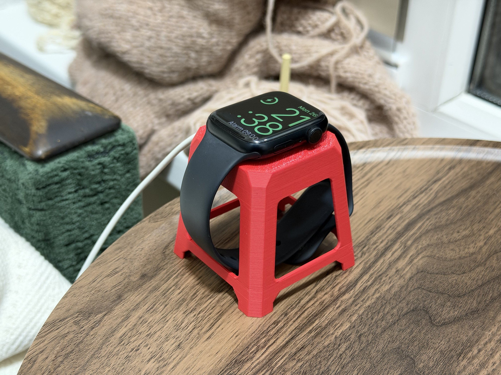

# 3D Prints

Source files for things I design and print: parametric OpenSCAD scripts, Autodesk Fusion designs, and print notes.

Printed on a Bambu Lab printer. Finished models are also published on [MakerWorld](https://makerworld.com/) and [Printables](https://www.printables.com/).

<picture>
  <source media="(prefers-color-scheme: dark)" srcset="https://raw.githubusercontent.com/artemnovichkov/artemnovichkov/print-heatmap/print-heatmap-dark.svg">
  
</picture>

Print activity from the Bambu Cloud history, updated daily by [print-heatmap](https://github.com/artemnovichkov/print-heatmap).

## Projects

<table>
<tr>
<td width="50%"><a href="designs/ringlet-calendar"></a></td>
<td valign="top">
<h3><a href="designs/ringlet-calendar">Ringlet</a></h3>
Customizable perpetual ring calendar.<br><br>
<a href="https://makerworld.com/en/models/3434752-ringlet-customizable-perpetual-ring-calendar">MakerWorld</a>
</td>
</tr>
<tr>
<td width="50%"><a href="designs/xcode-keychain"></a></td>
<td valign="top">
<h3><a href="designs/xcode-keychain">Xcode Icon Keychain</a></h3>
Multicolour keychain shaped like the Xcode icon, with an optional NFC tag.<br><br>
<a href="https://makerworld.com/en/models/3428461-xcode-icon-keychain-nfc-version">MakerWorld</a>
</td>
</tr>
<tr>
<td width="50%"><a href="designs/halloween-pumpkins"></a></td>
<td valign="top">
<h3><a href="designs/halloween-pumpkins">Shadow Pumpkins</a></h3>
Halloween pendants whose shadow shows one word with light from the left and another from the right.<br><br>
<a href="https://makerworld.com/en/models/3455788-halloween-shadow-pumpkins-two-word-illusion">MakerWorld</a>
</td>
</tr>
<tr>
<td width="50%"><a href="designs/kindle-typewriter"></a></td>
<td valign="top">
<h3><a href="designs/kindle-typewriter">Typewriter Kindle Stand</a></h3>
Kindle and e-reader stand shaped like a tiny typewriter, with a roller that slides on like a carriage return.<br><br>
<a href="https://makerworld.com/en/models/3472879-typewriter-kindle-e-reader-stand-customizable">MakerWorld</a> · <a href="https://www.printables.com/model/1886726-typewriter-kindle-e-reader-stand">Printables</a>
</td>
</tr>
<tr>
<td width="50%"><a href="designs/watch-stool"></a></td>
<td valign="top">
<h3><a href="designs/watch-stool">Watch Stool</a></h3>
Apple Watch charger stand shaped like a plastic street-food stool. The puck sits flush in the seat, and the stools stack like the real ones.<br><br>
<a href="https://makerworld.com/en/models/3499007-plastic-stool-apple-watch-charging-stand">MakerWorld</a> · <a href="https://www.printables.com/model/1891899-plastic-stool-apple-watch-charger-stand">Printables</a>
</td>
</tr>
</table>

## Repository layout

Each project lives in its own folder under `designs/`:

```
designs/project-name/
├── README.md          description, parameters, print settings
├── project-name.scad  OpenSCAD source (if parametric)
├── project-name.f3d   Autodesk Fusion source
├── build.json         printer, parts and filaments for the 3MF
├── models/
│   ├── project-name.stl   single mesh, previews in 3D on GitHub
│   └── project-name.3mf   Bambu Studio project, parts and colours assigned
└── images/
```

`models/` is generated from the `.scad` source, or from STLs exported from Fusion to `parts/` (gitignored) when there is none (needs [OpenSCAD](https://openscad.org), `brew install --cask openscad@snapshot`):

```sh
python3 scripts/build-models.py designs/project-name
```

The 3MF uses Bambu Studio settings from `scripts/templates/<printer>/` (P2S by default). If Bambu Studio is installed, the script also slices the 3MF and refreshes the print time and filament table between `<!-- print-info -->` markers in the project README.

## Claude Code setup

The repo ships with config for [Claude Code](https://claude.com/claude-code):

- `.mcp.json` — Autodesk Fusion MCP server (`http://127.0.0.1:27182/mcp`, Fusion must be running)
- `skills-lock.json` — [bambu-studio-ai](https://github.com/heyixuan2/bambu-studio-ai) skill

After cloning:

```sh
npx skills experimental_install
python3 -m pip install --user --break-system-packages -r .claude/skills/bambu-studio-ai/requirements.txt
python3 .claude/skills/bambu-studio-ai/scripts/doctor.py
```

## Licence

Unless a project says otherwise, everything here is licensed under [CC BY-NC-SA 4.0](LICENSE).

Made by [Artem Novichkov](https://artemnovichkov.com).
