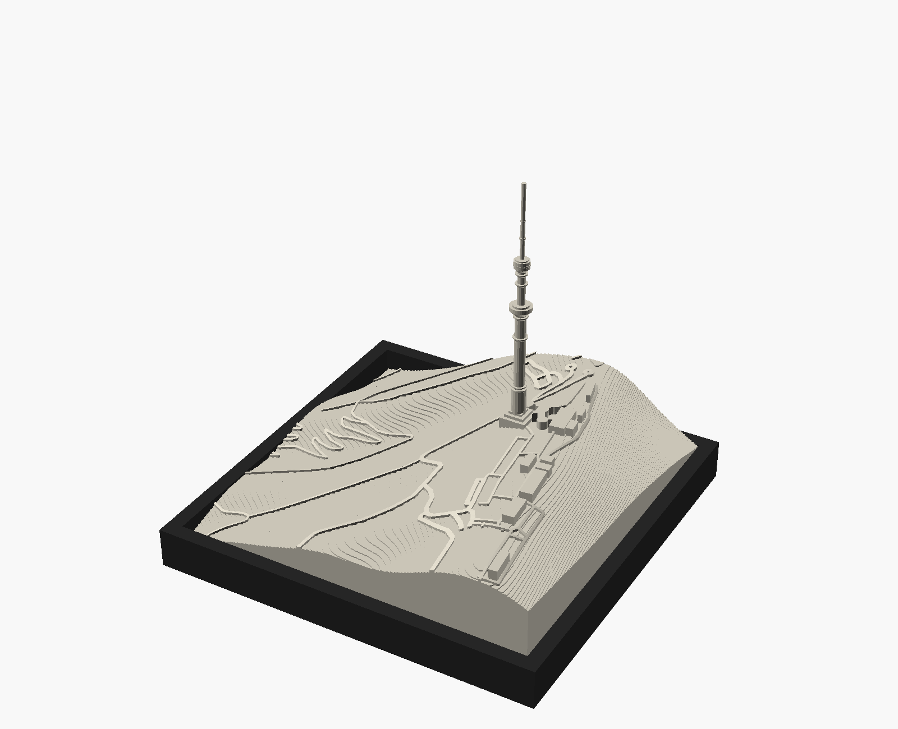
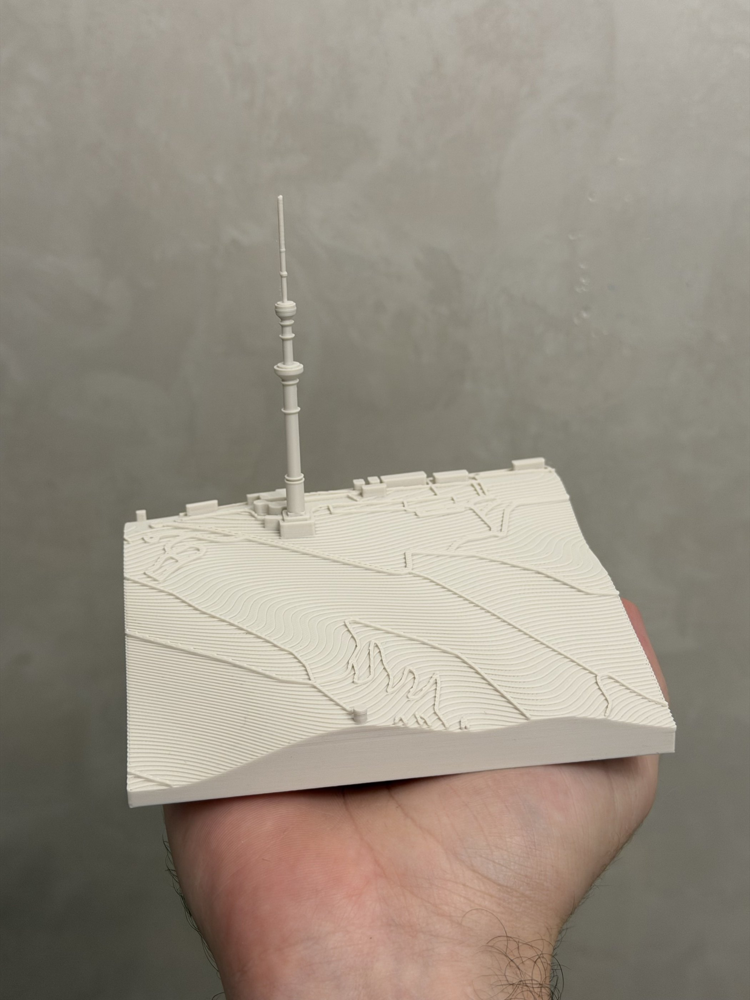
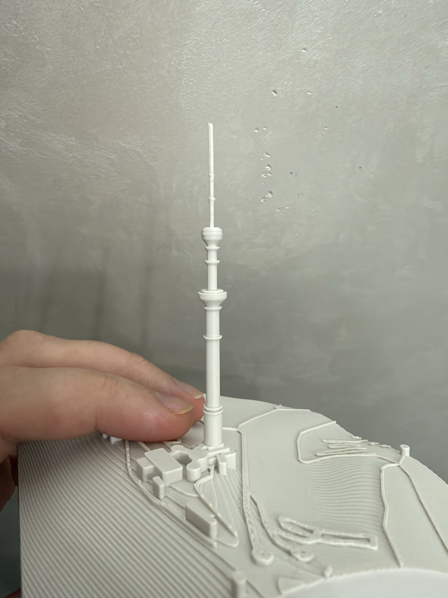
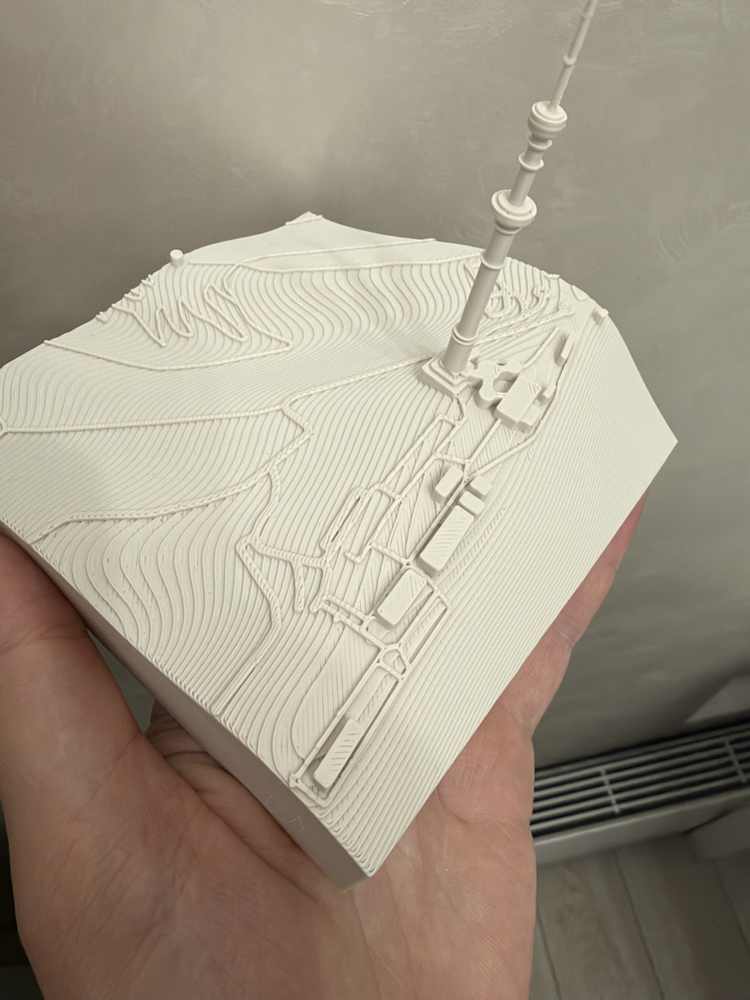

# Almaty TV Tower — Kok-Tobe Relief

A desk model of Kok-Tobe hill in Almaty with its 372 m TV tower. The relief, roads, paths and buildings come from open data; the tower prints apart and drops over a peg on the hill, so a broken one reprints without the terrain. The model sits in a black frame, printed separately.



| Printed, in hand | Tower with its pods and antenna | Terraces, roads and buildings from above |
|---|---|---|
|  |  |  |

## Files

| File | What it is |
|---|---|
| [`models/almaty-tv-tower.stl`](models/almaty-tv-tower.stl) | Terrain, frame and tower side by side, opens in GitHub's 3D viewer |
| [`models/almaty-tv-tower.3mf`](models/almaty-tv-tower.3mf) | Ready-to-print Bambu Studio project, one plate each: terrain and tower in sand PLA, frame in black |
| `almaty-tv-tower.scad` | OpenSCAD source |
| `terrain.scad` | Heightmap, roads, paths and buildings, generated by `scripts/terrain-data.py` |
| `build.json` | Parts and filaments used to build the 3MF |
| `images/` | OpenSCAD render and, in `photos/`, photos of the print |

## Parameters

| Group | Parameter | Default | Notes |
|---|---|---|---|
| Output | `part` | `all` | `all`, `terrain`, `tower`, `frame`, `tower-top` (print test of the antenna) or `fit-test` (peg sockets) |
| Size | `model_size` | `120` mm | Side of the square: 450 m of terrain, 1:3750. The model is 120 × 120 × 116 mm |
| | `relief_scale` | `1` | Vertical exaggeration of the hill. `1` is true scale: 114 m of relief, 30 mm |
| | `base_t` | `4` mm | Base under the lowest point |
| | `terrace_h` | `0.4` mm | Contour terraces, a multiple of the layer height. `0` gives a smooth surface |
| Roads | `road_w` / `path_w` / `road_h` | `1.5` / `0.8` / `0.6` mm | `path_w = 0` hides footpaths |
| Buildings | `building_scale` | `1.5` | Vertical exaggeration, `0` hides buildings |
| Tower | `tower_scale` / `tower_width` | `0.8` / `1` | Height and width over true scale. At `1` the tower is 99 mm tall |
| | `min_d` | `1.4` mm | Thinnest diameter (antenna mast) |
| | `plinth` | `9` mm | Stepped plinth on the terrain |
| | `separate_tower` | `true` | Print the tower apart and drop it over a peg on the terrain. `false` grows it out of the terrain |
| | `peg_d` / `peg_h` / `gap` | `3` / `5` / `0.1` mm | Peg on the terrain, its socket is in the tower base. `gap` is the clearance of the socket: `0.1` fits well on a P2S with PLA, `0.05` is so tight that the peg snapped when pulled out |
| Frame | `frame` | `true` | Show the terrain in its frame. The frame prints apart (`part = "frame"`) |
| | `frame_w` / `frame_h` / `frame_floor` | `5` / `12` / `1.6` mm | Wall width, wall height above the floor, floor |
| | `frame_gap` | `0.3` mm | Clearance between the terrain and the walls |

To model another place, regenerate the data:

```sh
python3 scripts/terrain-data.py --center 43.2317487,76.9749153 --size 450 --step 3 --poi 43.2322913,76.9756550 -o designs/almaty-tv-tower/terrain.scad
```

## Printing

<!-- print-info -->
| Plate | Contents | Filament | Time | Weight |
|---|---|---|---|---|
| 1 | Kok-Tobe | sand 59.2 g | 2 h 7 min | 59.2 g |
| 2 | Frame | black 46.1 g | 53 min | 46.1 g |
| 3 | Tower | sand 1.1 g | 19 min | 1.1 g |

Sliced for Bambu Lab P2S 0.4 nozzle, 0.20mm Standard, Bambu PLA Basic. Times differ on other printers.
<!-- /print-info -->

- Print the terrain flat with 0.2 mm layers. The relief is stepped into 0.4 mm contour terraces, so every step lands on a layer boundary.
- Lightning infill (15 %) fills only what holds up the top surface, so the solid-looking hill weighs about half as much.
- The antenna is 1.4 mm thick (`min_d`). `part = "tower-top"` renders only the top of the tower on a wide foot, a 14-minute print: print it first to check that the antenna comes out straight on your printer. If it wobbles, raise `min_d` or replace the antenna with a 1–1.5 mm steel pin.
- The tower prints upright on its 9 mm plinth and drops over the peg on the terrain; a square key lines the plinth up with its footing, and the roads and buildings around it stop 0.3 mm short. Its socket has 45° roofs, so it needs no bridges or supports. Add a drop of glue if you don't want it to lift off.
- `part = "fit-test"` prints three tower bases with sockets at `gap` − 0.05, `gap` and `gap` + 0.05 mm, marked with 1, 2 and 3 dots, and a peg for each. Print it before the full terrain.
- The frame is a 130.6 × 130.6 × 13.6 mm tray. The terrain drops into it with 0.3 mm of clearance; on the downhill sides the walls rise above the terrain edge, uphill the white slope shows above them.
- Keep part cooling at maximum: the top of the tower prints fast, layer after layer.

## Data

Tower profile measured from the [lighting design drawing](https://commons.wikimedia.org/wiki/File:%D0%9F%D1%80%D0%BE%D0%B5%D0%BA%D1%82_%D0%B1%D0%B0%D1%88%D0%BD%D0%B8_%D0%9A%D0%BE%D0%BA%D1%82%D0%BE%D0%B1%D0%B5_%D0%B2_%D0%90%D0%BB%D0%BC%D0%B0%D1%82%D1%8B.jpg) on Wikimedia Commons: stepped shaft, pods at 171–181 m and 236–253 m, balconies and antenna platforms at their real heights.

Map data © [OpenStreetMap](https://www.openstreetmap.org/copyright) contributors (ODbL). Elevation: Copernicus GLO-30 DEM © DLR e.V. 2010–2014 and © Airbus Defence and Space GmbH 2014–2018, provided under COPERNICUS by the European Union and ESA.

## Licence

[CC BY-NC-SA 4.0](../../LICENSE). Share and remix for non-commercial use with attribution.
