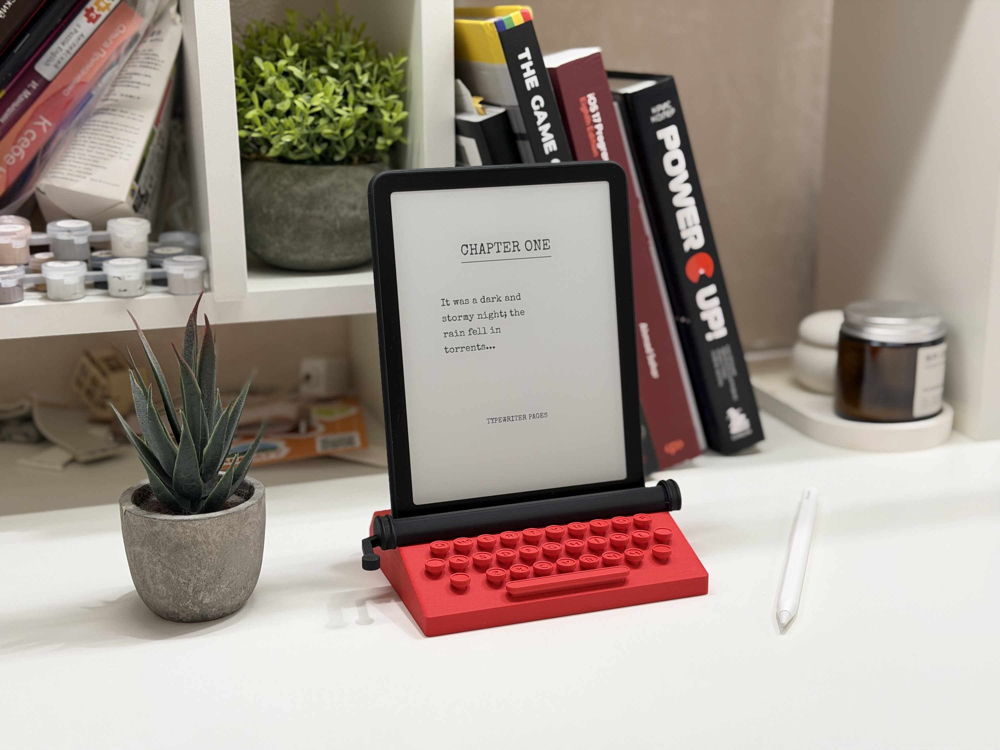
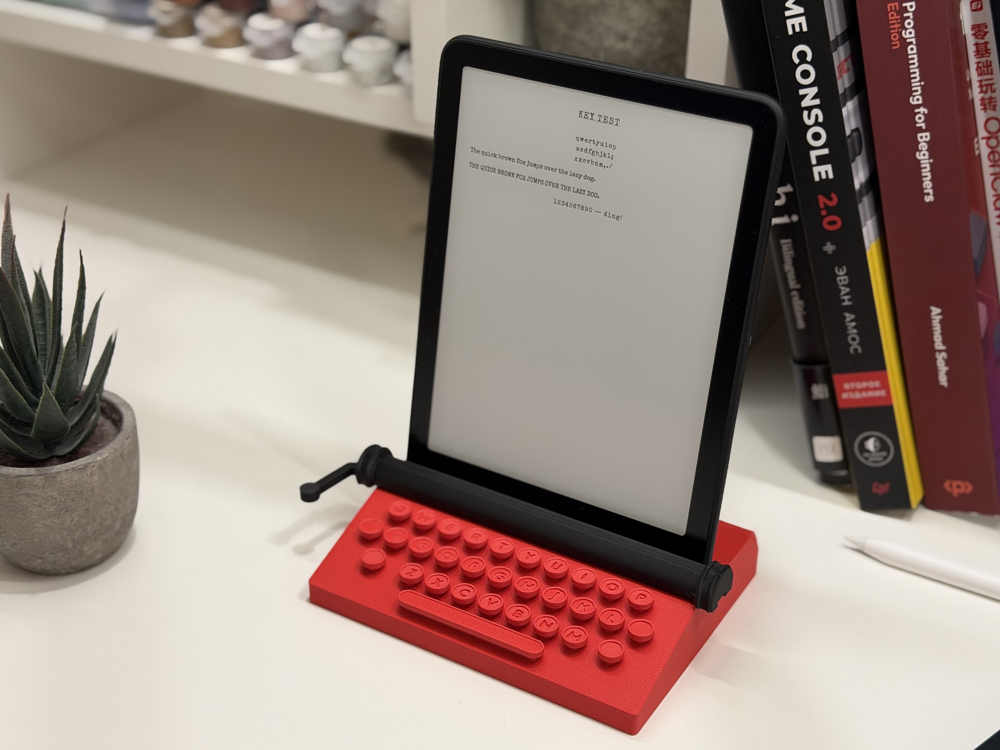
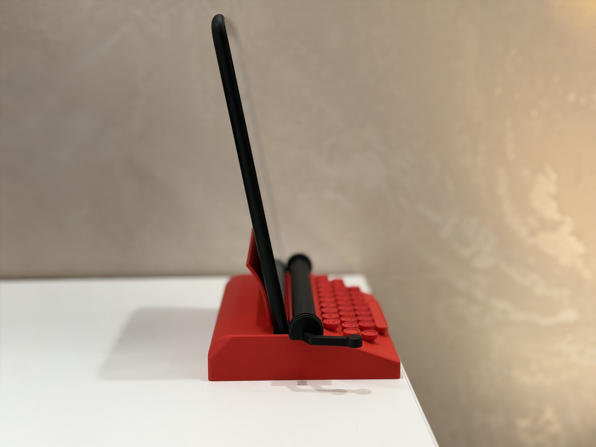
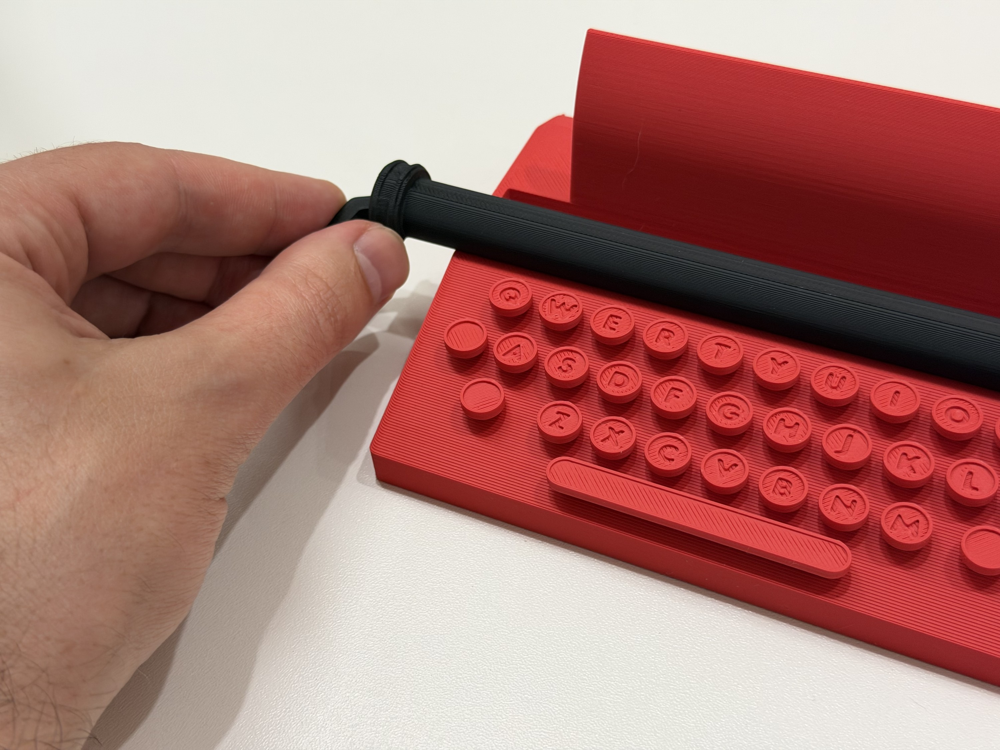

# Typewriter Kindle & E-Reader Stand

Your Kindle stands in a tiny typewriter like a sheet of paper. The roller hides the bottom bezel, so you see only the page, and the keys carry debossed QWERTY letters. I made it for my own desk.

| Keys | Side view | Roller slides on from the left |
|---|---|---|
|  |  |  |

The model is parametric: pick a Kindle Paperwhite from the list or enter any e-reader's width and thickness, add the thickness of a case, and change the tilt.

## Files

| File | What it is |
|---|---|
| [`models/kindle-typewriter.stl`](models/kindle-typewriter.stl) | Body and roller side by side, opens in GitHub's 3D viewer |
| [`models/kindle-typewriter.3mf`](models/kindle-typewriter.3mf) | Ready-to-print Bambu Studio project for a Kindle Paperwhite 6 (2024): plate 1 is the body, plate 2 the roller |
| `models/kindle-typewriter-pw5.3mf`, `-pw4.3mf`, `-pw3.3mf` | The same for Kindle Paperwhite 5 (2021), 4 (2018) and 3 (2015) |
| `kindle-typewriter.scad` | OpenSCAD source. Upload it to the MakerWorld Parametric Model Maker or open it in OpenSCAD 2021.01+ |
| `kindle-typewriter.f3d` | Autodesk Fusion render scene for `images/render-*.png`: meshes exported from the `.scad`, a Kindle mock-up, oak desk and camera. Not a parametric design |
| `build.json` | Parts, filaments and variants used to build the 3MF |
| `images/` | Photos and renders used in this README and on MakerWorld |

## Parameters

| Group | Parameter | Default | Notes |
|---|---|---|---|
| E-reader | `device` | `pw6` | `pw3`, `pw4`, `pw5`, `pw6` (Kindle Paperwhite 3–6) or `custom` |
| | `custom_width` / `custom_thickness` | `127.6` / `7.8` mm | Used when `device = custom`. Widths from 104 mm |
| | `case_extra` | `0` mm | Extra thickness of a case or cover |
| | `tilt` | `10`° | Backward lean, 5–18° |
| Fit | `clearance` | `0.4` mm | Gap in front of and behind the device |
| | `side_clearance` | `0.5` mm | Gap on each side. Printed slots come out narrower than modelled: raise it if the device doesn't drop in |
| | `dt_gap` | `0.15` mm | Gap in the roller's dovetail: raise it by 0.05 mm if the roller is hard to slide on, lower it if it is loose |
| Hidden | `part` | `plates` | Renders nothing at the top level, because MakerWorld builds its plates from `mw_plate_1()` (body) and `mw_plate_2()` (roller). Pass `-D part="all"` (or `body`, `roller`, `fit_test`) locally |

`fit_test` is a thin strip of the body around the slot: print it first to check the fit without printing the whole body.

## Printing

<!-- print-info -->
| Plate | Contents | Filament | Time | Weight |
|---|---|---|---|---|
| 1 | Typewriter | coral 100.5 g | 2 h 15 min | 100.5 g |
| 2 | Roller | black 10.0 g | 24 min | 10.0 g |

Sliced for Bambu Lab P2S 0.4 nozzle, 0.20mm Standard, Bambu PLA Basic. Times differ on other printers.
<!-- /print-info -->

PLA, 0.4 mm nozzle, 0.2 mm layers, no supports. One colour per plate, so no AMS is needed. The body prints flat, the roller on its flat side; Arachne walls and the back seam are set in the 3MF.

`models/kindle-typewriter.3mf` fits a Kindle Paperwhite 6 (2024). Other Paperwhites have their own 3MF:

Kindle Paperwhite 5 (2021), `models/kindle-typewriter-pw5.3mf`:

<!-- print-info:pw5 -->
| Plate | Contents | Filament | Time | Weight |
|---|---|---|---|---|
| 1 | Typewriter | coral 98.8 g | 2 h 13 min | 98.8 g |
| 2 | Roller | black 9.8 g | 24 min | 9.8 g |

Sliced for Bambu Lab P2S 0.4 nozzle, 0.20mm Standard, Bambu PLA Basic. Times differ on other printers.
<!-- /print-info:pw5 -->

Kindle Paperwhite 4 (2018), `models/kindle-typewriter-pw4.3mf`:

<!-- print-info:pw4 -->
| Plate | Contents | Filament | Time | Weight |
|---|---|---|---|---|
| 1 | Typewriter | coral 93.8 g | 2 h 8 min | 93.8 g |
| 2 | Roller | black 9.3 g | 23 min | 9.3 g |

Sliced for Bambu Lab P2S 0.4 nozzle, 0.20mm Standard, Bambu PLA Basic. Times differ on other printers.
<!-- /print-info:pw4 -->

Kindle Paperwhite 3 (2015), `models/kindle-typewriter-pw3.3mf`:

<!-- print-info:pw3 -->
| Plate | Contents | Filament | Time | Weight |
|---|---|---|---|---|
| 1 | Typewriter | coral 94.0 g | 2 h 9 min | 94.0 g |
| 2 | Roller | black 9.3 g | 24 min | 9.3 g |

Sliced for Bambu Lab P2S 0.4 nozzle, 0.20mm Standard, Bambu PLA Basic. Times differ on other printers.
<!-- /print-info:pw3 -->

## Assembly

The roller slides onto a dovetail like a carriage return: put it on from the left and push it right with the lever until it clicks. No glue, and it can't lift off. The device can't be charged while it stands in the dock.

## Licence

[CC BY-NC-SA 4.0](../../LICENSE). Share and remix for non-commercial use with attribution.
