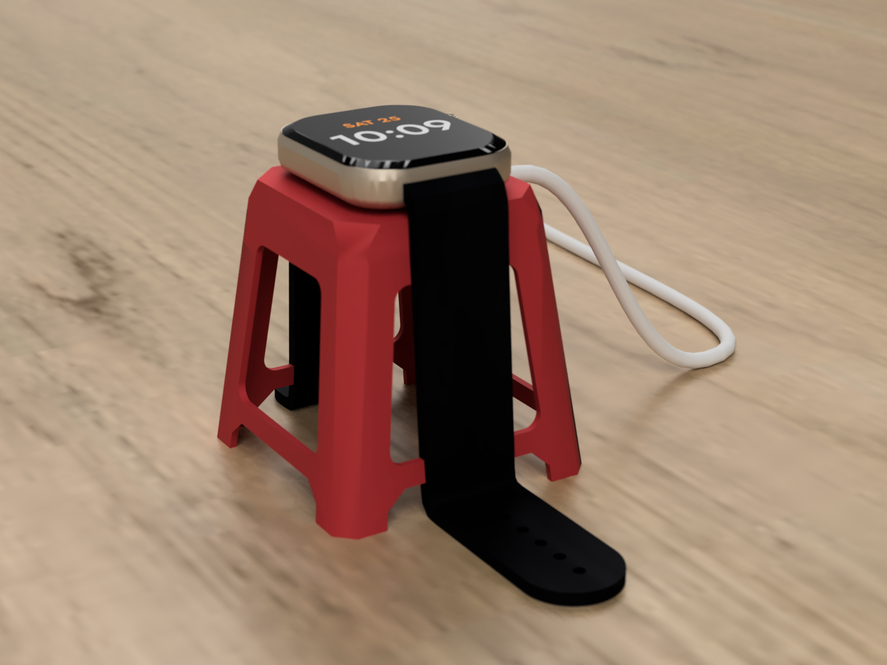
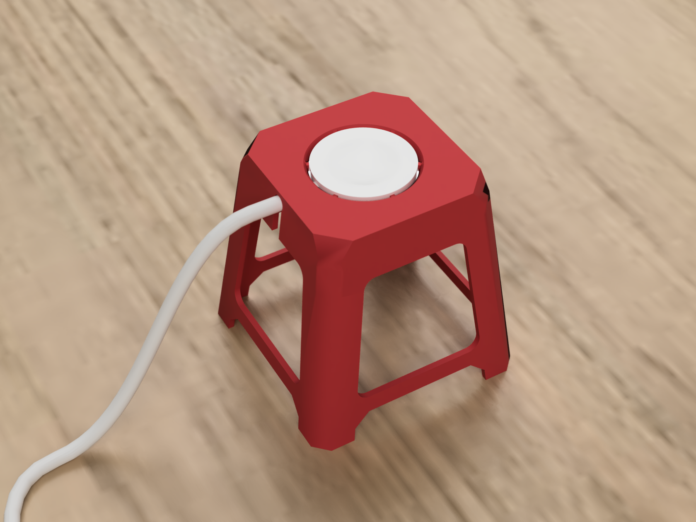
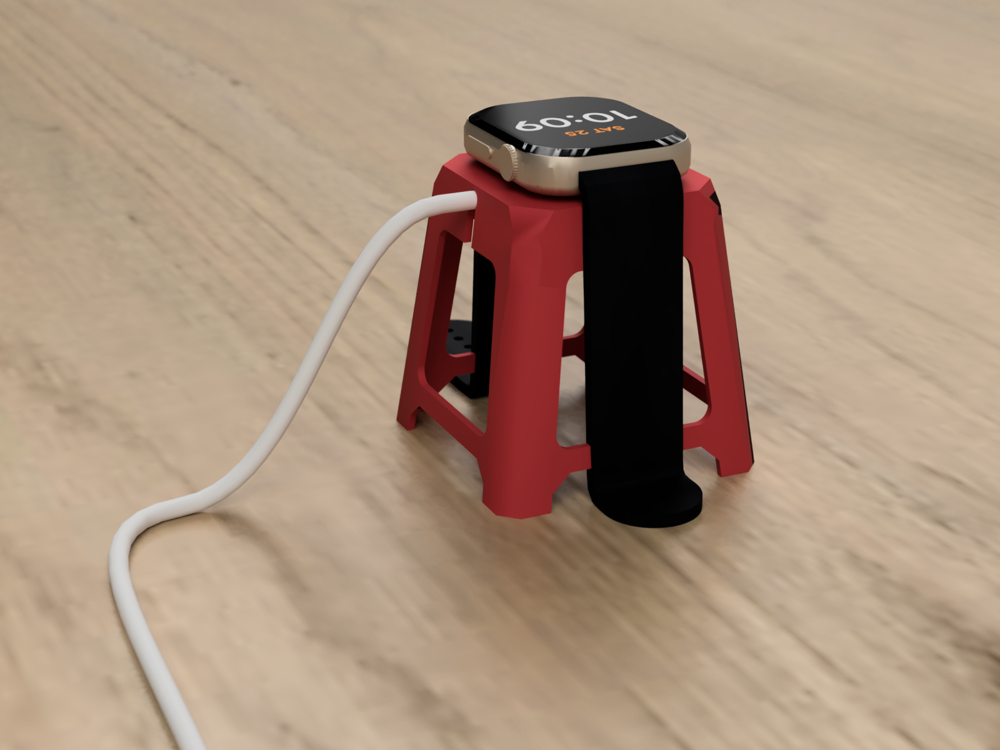
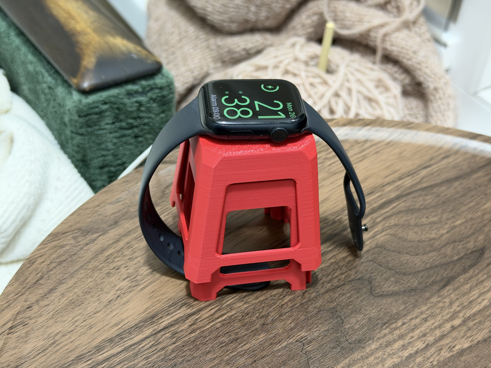
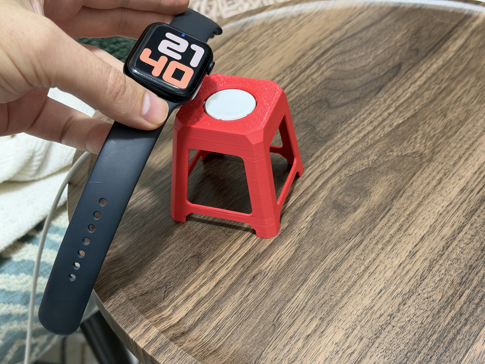

# Watch Stool — Apple Watch Charger Stand

A tiny plastic street-food stool for the Apple Watch charger. The puck sits in the seat, the watch lies on top with its bands over the edges or tucked through a window so they don't dangle, and the cable runs straight out of the side of the seat and hangs down to the table.

| Seat with the puck | Cable leaves the side of the seat |
|---|---|
|  |  |

| Printed, charging | Two stools stacked | Watch off, puck stays |
|---|---|---|
|  |  |  |

## How it works

- **The puck sits flush with the seat.** The dome on the watch back sticks out 2.44 mm ([Apple's dimensional drawing](https://developer.apple.com/accessories/dimensional-drawings/)), so the watch rests on the puck, not on the seat, and the magnet lines it up.
- **Crush ribs hold the puck.** Six thin ribs squeeze it, so the puck stays in when you lift the watch off, and the fit forgives a few tenths of a millimetre.
- **The seat shows only a round pocket.** The braided cable leaves the side of the puck under about 1 mm of seat and runs straight out of the middle of the right side, between the bands that hang over the front and back.
- **The cable hangs, it doesn't lie by a foot.** The braided cable is stiff: routed down a leg and out at the table, it pressed on the table next to the foot and lifted the leg. Out of the side of the seat it hangs down in a loose arc and lies down well away from the stool, so all four feet stay on the table.
- **A clip holds the cable straight.** From the pocket to the outside the cable presses up past a narrow opening, 0.4 mm narrower than the cable, into a round channel. Nothing bends it inside the stool, so its weight can't tip the far side of the puck up. The opening runs on down through the wall to the window below, so the cable snaps in from below all the way out.
- **The puck rests on a 45° ledge, not a flat floor.** The seat prints face down, so a flat floor would have to bridge over the pocket. The ledge prints without bridges, and the puck's rounded bottom edge centres itself on it.
- **The USB-C plug goes through the pocket.** The hole inside the ledge is 21 mm across, wide enough for the plug and a finger, and a slit in the ledge leads from it to the cable run, so nothing has to be threaded under the seat.
- **To take the puck out**, push it up with a finger through the same hole from below: the side opposite the cable comes up first.
- **The windows are handles.** Hold the stool through a window with two fingers and tilt the watch off with the other hand. Each side has one big window above the bottom rail, like the real thing, and through them you reach the clip under the seat.
- **The seat is about the size of the watch** (48 mm), so the bands bend down right away. Like a moulded plastic stool, the legs run straight up into the seat with no overhang, the leg corners widen into bevels at the corners of the seat, and the openings between the feet have chamfered corners. The feet spread to 64 mm.
- **The stools stack like the real ones.** The legs splay and the walls are 1.6 mm thin, so each stool sits only 15 mm higher than the one below (`part = stack` shows three). Short stops in the corners under the seat rest on the corners of the stool below, so the walls keep a 0.3 mm gap and never wedge together.

Flat charging only: nightstand mode needs the watch on its side.

## Files

| File | What it is |
|---|---|
| [`models/watch-stool.stl`](models/watch-stool.stl) | The stool, opens in GitHub's 3D viewer |
| [`models/watch-stool.3mf`](models/watch-stool.3mf) | Ready-to-print Bambu Studio project |
| `models/parts/stool-red.stl` | The stool for other slicers |
| `watch-stool.scad` | OpenSCAD source. Upload it to the MakerWorld Parametric Model Maker or open it in OpenSCAD 2021.01+ |
| `watch-stool.f3d` | Autodesk Fusion render scene for `images/render-*.png`: meshes from the `.scad`, a watch, band, puck and cable, oak desk. Not a parametric design |
| `build.json` | Parts, filament and print settings used to build the 3MF |
| `images/` | Renders and, in `photos/`, photos of the print used in this README and on MakerWorld. `render-props.scad` builds the props for the Fusion scene: Apple Watch Series 11 46 mm after Apple's dimensional drawing, sport band, puck and cable |

## Parameters

| Group | Parameter | Default | Notes |
|---|---|---|---|
| Charger | `puck_d` | `28` mm | Puck diameter, from the [iFixit Apple Watch teardown](https://www.ifixit.com/Teardown/Apple+Watch+Teardown/40655). Apple doesn't publish it, and people measure 27.5–28 mm: check yours with calipers |
| | `puck_h` | `6.7` mm | Puck thickness, also from iFixit |
| | `cable_d` | `4` mm | Diameter of the braided cable, measured from a photo: check yours. Sets the clip under the seat |
| Fit | `grip` | `0.5` mm | How much the crush ribs squeeze the puck. Raise it if the puck lifts off with the watch, lower it if the puck doesn't go in |
| | `clip_squeeze` | `0.4` mm | How much narrower than the cable the opening of the clip is. Raise it if the cable falls out of the clip |
| Output | `part` | `stool` | `stool` or `fit_test` (the seat only), both upside down, ready to print |

Print `fit_test` first to check the puck fit and the run under the seat: it takes a fraction of the filament.

The Customizer shows only what a printer may need to change. The rest sits under `/* [Hidden] */` in the `.scad`:

- `puck_proud` (`0` mm): how far the puck sticks out above the seat. Raising it thins the seat over the cable.
- `cable_exit` (`3.35` mm): height of the cable centre above the bottom of the puck. OpenSCAD warns if less than 0.8 mm of seat is left over the cable.
- `plug_w` (`14` mm): diagonal of the USB-C plug's housing. The hole inside the ledge is at least 2 mm wider, and 21 mm by default.
- `height` (`64` mm), `top_w` (`48` mm, also the seat), `bottom_w` (`64` mm: wider is steadier and stacks deeper), `wall` (`1.6` mm: thicker walls stack further apart, OpenSCAD echoes the step).
- More `part` values: `stack_test` is the seat beside the ring of the stool above it, upside down: push the seat up into the ring and it stops on the corner stops. `all` shows the stool with a puck, cable and watch, `stack` three stacked stools.

## Printing

<!-- print-info -->
| Plate | Contents | Filament | Time | Weight |
|---|---|---|---|---|
| 1 | Watch Stool | red 21.6 g | 49 min | 21.6 g |

Sliced for Bambu Lab P2S 0.4 nozzle, 0.20mm Standard, Bambu PLA Basic. Times differ on other printers.
<!-- /print-info -->

PLA, 0.4 mm nozzle, 0.2 mm layers, no supports. The stool prints upside down, seat on the plate, so the seat comes out flat and nothing needs supports: only the window edges bridge, the puck rests on a 45° ledge, and the skin over the cable run is the first layers on the plate. The 3MF has 3 walls, 25% infill, Arachne walls and the seam at the back, so the stool is heavy enough to stay put when you lift the watch off.

## Assembly

1. Push the USB-C plug down through the hole in the middle of the pocket and pull it out of the bottom of the stool.
2. Slide the cable along the slit in the ledge to the right edge of the pocket, push it under the edge, and press it up into the clip under the seat from below, all the way out through the slot in the right side.
3. Tilt the puck, slide its cable side under the edge of the pocket, then press the other side down until the puck sits on the ledge, flush with the seat.
4. Let the cable hang down to the table in a loose arc: pulled tight, it tugs the stool sideways.

## Licence

[CC BY-NC-SA 4.0](../../LICENSE). Made by [Artem Novichkov](https://artemnovichkov.com).
