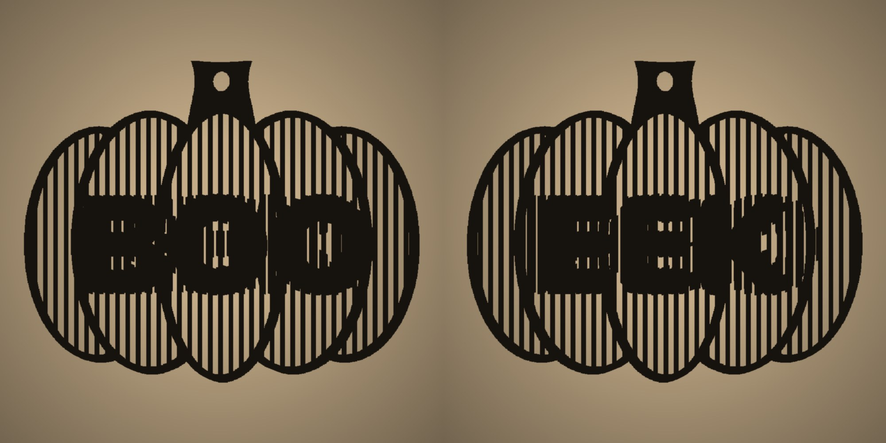
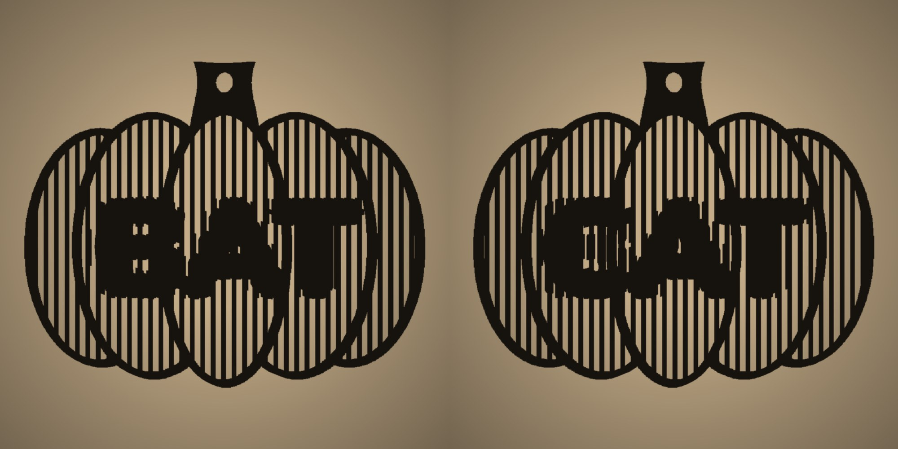
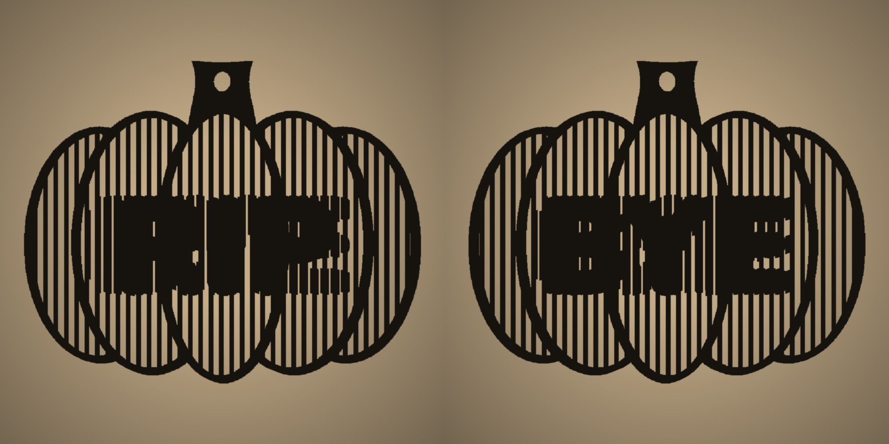

# Shadow Pumpkins — Two Words in One Shadow

Flat pumpkin pendants that hide two words each. Light one from the left and its shadow on the wall says BOO; move the light to the right and it says EEK.



Each pumpkin is a grid of thin vertical slats split lengthwise. Light from the left is blocked by the right half of the slat to the left of each gap, so raising the right halves inside a word turns that word solid in the shadow. The left halves do the same for light from the right. Away from the words a slat is a single 0.5 mm line, which keeps the rest of the shadow bright and the words easy to read.

| Pair | Light from the left · from the right |
|---|---|
| BOO / EEK |  |
| BAT / CAT |  |
| RIP / BYE |  |
| OMG / RUN |  |

## Files

| File | What it is |
|---|---|
| [`models/halloween-pumpkins.stl`](models/halloween-pumpkins.stl) | All four pumpkins, opens in GitHub's 3D viewer |
| [`models/halloween-pumpkins.3mf`](models/halloween-pumpkins.3mf) | Ready-to-print Bambu Studio project: four pumpkins on one plate |
| `halloween-pumpkins.scad` | OpenSCAD source: words, font, slats, pumpkin size. `part = "custom"` makes a pumpkin with your own words |
| `halloween-pumpkins.f3d` | Autodesk Fusion design: the four pumpkins as bodies |
| `build.json` | Objects and filament used to build the 3MF |
| `images/` | Simulated shadows used in this README |

The pumpkin follows the one in [ShadowSays](https://shadowsays.vercel.app), a web app for shadow illusion pendants, with thin slats away from the words. The images come from `scripts/shadow-sim.py`, which traces the shadow of an STL lit by a lamp 40 cm away at 30°:

```sh
openscad --backend=manifold -D 'part="boo-eek"' -o boo-eek.stl halloween-pumpkins.scad
python3 ../scripts/shadow-sim.py boo-eek.stl boo.png --angle 30 --lamp 400
```

## Parameters

| Group | Parameter | Default | Notes |
|---|---|---|---|
| Output | `part` | `all` | `all`, one pumpkin (`boo-eek`, `bat-cat`, `rip-bye`, `omg-run`) or `custom` |
| Custom words | `left_text` / `right_text` | `BOO` / `EEK` | Shown with light from the left / right. Three or four letters fit |
| Text | `font` | `Nunito:style=Black` | A heavy font reads best |
| | `text_size`, `bold`, `text_offset` | `18`, `0.6`, `0` mm | |
| Slats | `slat_w` / `gap_w` | `1.2` / `0.8` mm | |
| | `low_h` / `high_h` | `0.6` / `1.6` mm | The words show between about 27° and 34° |
| | `spine_w` | `0.5` mm | Slat width away from the words, `0` for full slats |
| Pumpkin | `width` | `76` mm | |
| | `frame_w`, `frame_h`, `ribs`, `rib_w`, `hole_d` | `1.2`, `1.2`, on, `1.2`, `4` mm | |

## Printing

76 × 62 mm with the stem, 1.6 mm thick. One colour, PLA, 0.4 mm nozzle, 0.2 mm layers, no supports. The 3MF turns on the Arachne wall generator so the 0.5 mm slats print as single lines.

<!-- print-info -->
| Plate | Contents | Filament | Time | Weight |
|---|---|---|---|---|
| 1 | BOO / EEK, BAT / CAT, RIP / BYE, OMG / RUN | orange 7.7 g | 41 min | 7.7 g |

Sliced for Bambu Lab P2S 0.4 nozzle, 0.20mm Standard, Bambu PLA Basic. Times differ on other printers.
<!-- /print-info -->

## Hanging

Thread a string through the hole in the stem and hang the pumpkin 5–10 cm from a wall. In a dark room, light it from the side with a phone flashlight or a candle at least 40 cm away, about 30° off the line straight at the wall. Move the light to the other side to flip the word. The closer the lamp, the more the angle changes across the pumpkin, and the edges of the word blur.

Make your own words at [shadowsays.vercel.app](https://shadowsays.vercel.app). Printed one? Post it with #shadowsays.
