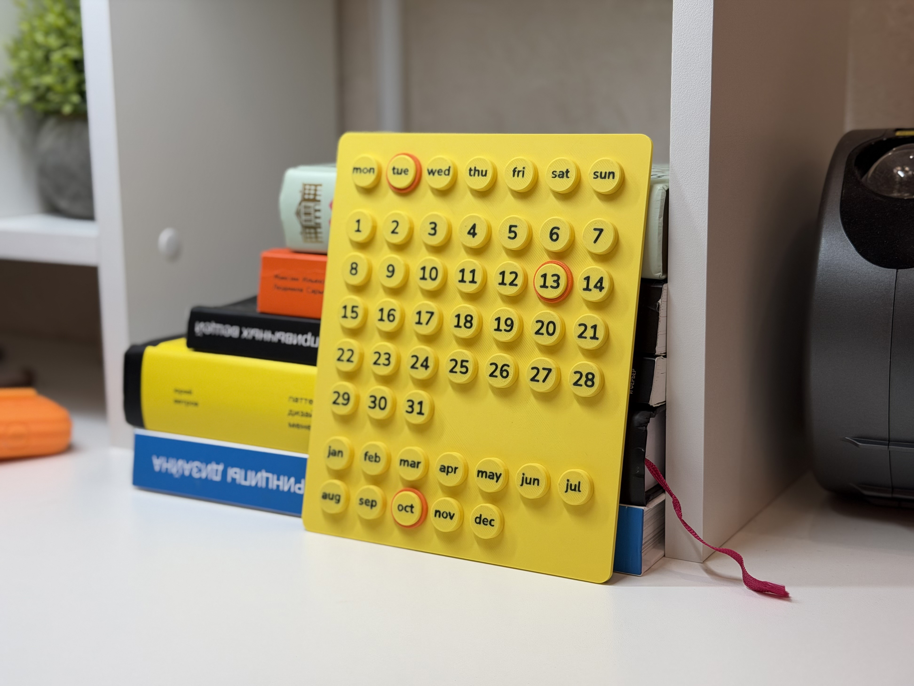

# Ringlet — Customizable Perpetual Ring Calendar

A reusable desk calendar: slip one ring over the weekday, one over the date and one over the month. No batteries, no pages to tear off, works every year.

The whole model is parametric. Change the language, the first day of the week, peg size, ring clearance or font, and the layout rebuilds itself.

| English, week starts on Monday | English, week starts on Sunday | Russian, week starts on Monday |
|---|---|---|
|  |  |  |

## Files

| File | What it is |
|---|---|
| [`models/ringlet-calendar.stl`](models/ringlet-calendar.stl) | Base with engraved labels and rings, opens in GitHub's 3D viewer |
| [`models/ringlet-calendar.3mf`](models/ringlet-calendar.3mf) | Ready-to-print Bambu Studio project: plate 1 is the two-colour calendar, plate 2 the rings |
| [`models/ringlet-calendar-no-ams.3mf`](models/ringlet-calendar-no-ams.3mf) | Same for printers without AMS: raised text and a filament change to swap by hand |
| `ringlet-calendar.scad` | OpenSCAD source. Upload it to the MakerWorld Parametric Model Maker or open it in OpenSCAD 2021.01+ |
| `ringlet-calendar.f3d` | Original Autodesk Fusion design with user parameters and the Fusion Render scene for `images/render-desk.png` |
| `build.json` | Parts and filaments used to build the 3MF |
| `images/` | Renders used in this README |

## Parameters

| Group | Parameter | Default | Notes |
|---|---|---|---|
| Output | `part` | `all` | `all`, `base`, `labels`, `rings` |
| | `ring_count` | `3` | Weekday, date and month |
| Labels | `language` | `en` | `en`, `ru` or `custom` |
| | `week_start` | `mon` | `mon` or `sun` |
| | `custom_days`, `custom_months` | — | Comma-separated lists, used when `language = custom` |
| | `font` | `Nunito:style=Bold` | Any Google Fonts name works on MakerWorld |
| | `text_size` | `4.25` mm | Weekdays and months. Long labels shrink automatically |
| | `date_size` | `6` mm | Dates 1–31 |
| | `label_style` | `inlay` | `inlay` (flush, two colours) or `raised` |
| | `text_depth` | `0.4` mm | Inlay depth or raised height |
| Pegs | `peg_d` / `peg_h` | `14` / `4` mm | |
| | `peg_chamfer` | `0.4` mm | Helps the ring slide on |
| | `peg_spacing` | `1.7` mm | Free space between a worn ring and the next peg |
| Plate | `plate_t`, `margin`, `group_gap`, `corner_r` | `3`, `10`, `5`, `5` mm | |
| Rings | `gap` | `0.15` mm | Ring-to-peg clearance: snug enough that rings stay on when the calendar is tilted. Tune this for your printer |
| | `ring_wall` / `ring_h` / `ring_chamfer` | `1.5` / `2` / `0.3` mm | |

The grid pitch and plate size are derived from the values above. With the defaults the plate is 147 × 176 mm and fits any Bambu Lab printer, including the A1 mini (just).

## Printing

<!-- print-info -->
| Plate | Contents | Filament | Time | Weight |
|---|---|---|---|---|
| 1 | Ringlet | yellow 78.3 g, black 1.4 g | 2 h 58 min | 79.7 g |
| 2 | Rings | orange 0.5 g | 9 min | 0.5 g |

Sliced for Bambu Lab P2S 0.4 nozzle, 0.20mm Standard with 0.12mm layers, Bambu PLA Basic. Times differ on other printers.
<!-- /print-info -->

Without AMS (`models/ringlet-calendar-no-ams.3mf`):

<!-- print-info:no-ams -->
| Plate | Contents | Filament | Time | Weight |
|---|---|---|---|---|
| 1 | Ringlet | yellow 78.7 g, black 0.7 g | 2 h 44 min | 79.4 g |
| 2 | Rings | orange 0.5 g | 9 min | 0.5 g |

Sliced for Bambu Lab P2S 0.4 nozzle, 0.20mm Standard with 0.12mm layers, Bambu PLA Basic. Times differ on other printers.
<!-- /print-info:no-ams -->

- **Two colours, default settings.** Open `models/ringlet-calendar.3mf`, pick your printer and filaments, print.
- **Two colours, custom settings.** Export `base` and `labels` separately, import both into Bambu Studio, and when asked choose to load them as a single object with multiple parts. Assign a filament to each part.
- **Two colours without AMS.** Open `models/ringlet-calendar-no-ams.3mf`. The text is raised, and a filament change at the first text layer (Z 7.16 mm with default settings) stops the printer: swap to the text filament and resume. Bambu Studio previews the text in that colour. For custom settings, set `label_style = raised` and add a filament change at the first layer above the pegs.
- **Rings.** Print one ring and a small test first. If it is too tight, increase `gap` by 0.05 mm; if it falls off, decrease it.
- Suggested settings: 0.12 mm layers for crisp text, 0.4 mm nozzle, 15 % infill, no supports, prime tower on so the text colour does not smear.

## Licence

[CC BY-NC-SA 4.0](../LICENSE). Share and remix for non-commercial use with attribution.
