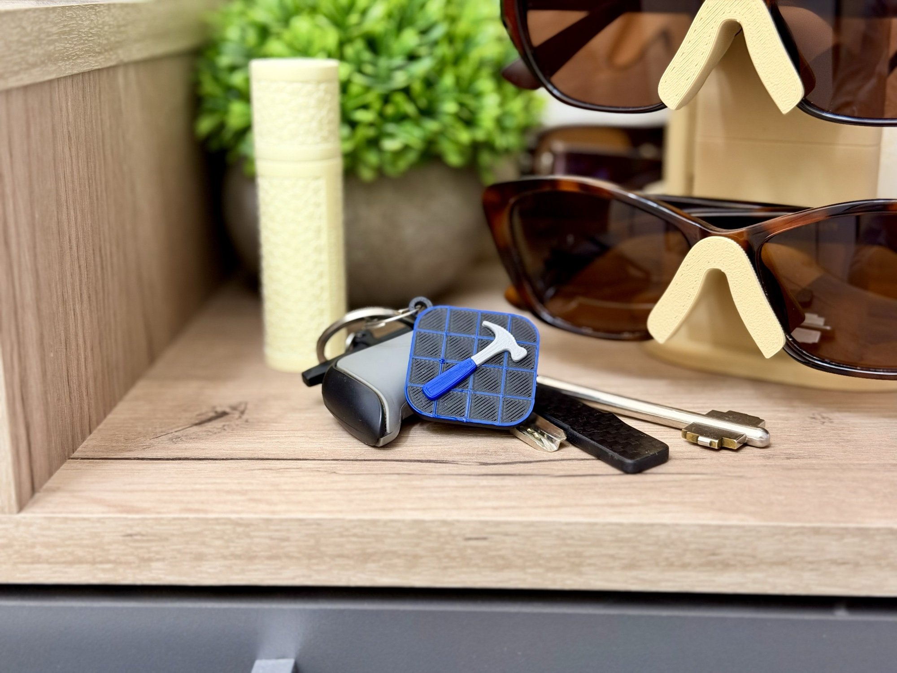
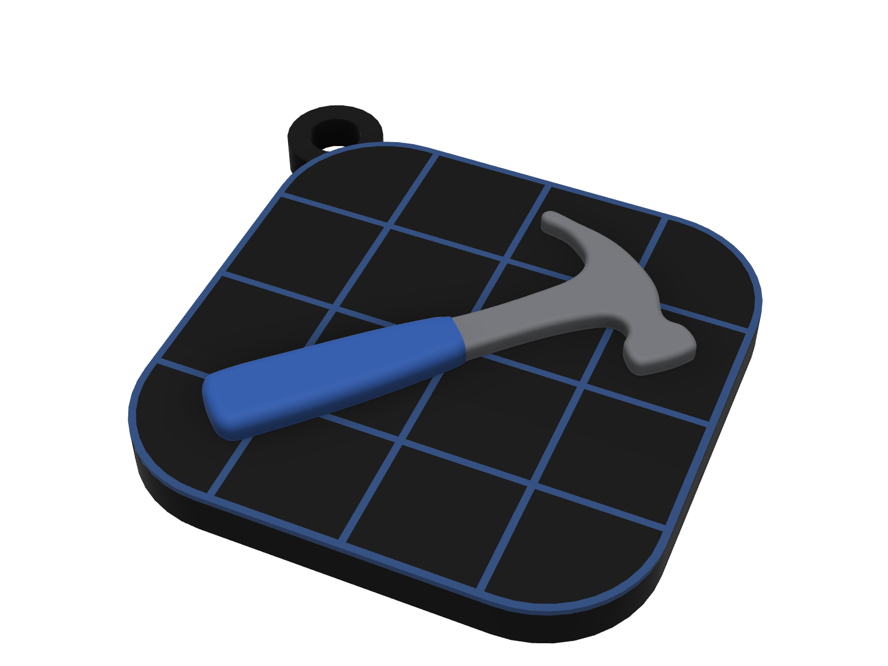
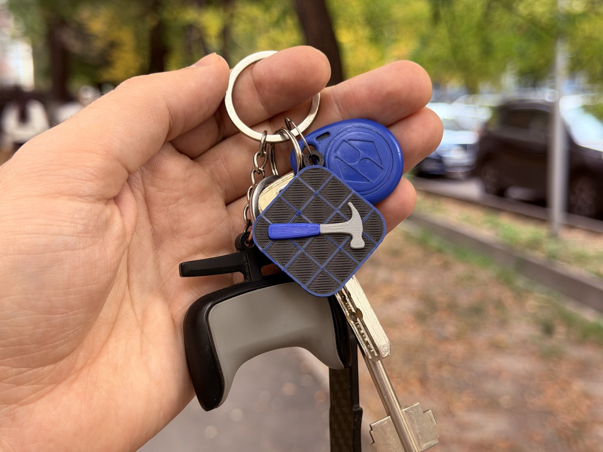

# Xcode Icon Keychain

A keychain shaped like the Xcode app icon: a rounded blueprint tile with a flush blue grid and a raised hammer on top. Prints in one go with an AMS, no supports.

| Render | On keys |
|---|---|
|  |  |

Size: 34.6 × 34.6 × 4.6 mm, with a 3 mm tile and a key-ring loop in the corner.

## Files

| File | What it is |
|---|---|
| [`models/xcode-keychain.stl`](models/xcode-keychain.stl) | Single mesh, opens in GitHub's 3D viewer (grid inlay left out) |
| [`models/xcode-keychain.3mf`](models/xcode-keychain.3mf) | Ready-to-print Bambu Studio project, four parts with filaments assigned |
| [`models/xcode-keychain-nfc.3mf`](models/xcode-keychain-nfc.3mf) | Same with a hidden pocket for an NFC sticker and a pause to insert it |
| `xcode-keychain.f3d` | Autodesk Fusion design with user parameters |
| `build.json` | Parts and filaments used to build the 3MF |
| `images/` | Render and photos used in this README |

The model is designed in Fusion, so there is no `.scad`. After changing the design, export each body to `parts/<body>.stl` (gitignored; `Base NFC` → `base-nfc.stl`) and run `python3 scripts/build-models.py xcode-keychain`.

## Parameters

Fusion user parameters:

| Parameter | Default | Notes |
|---|---|---|
| `thickness` | `3` mm | Tile thickness |
| `inlay_d` | `0.4` mm | Grid inlay depth |
| `hammer_h` | `1.2` mm | Hammer height above the tile |
| `grip_h` | `0.4` mm | Extra grip height above the hammer |
| `head_r` / `grip_r` | `0.405` / `0.85` mm | Top fillets of the head and grip |
| `nfc_d` / `nfc_h` / `nfc_z` | `26` / `0.6` / `1` mm | NFC pocket diameter, height and floor height (hidden `Base NFC` body) |

## Printing

<!-- print-info -->
| Plate | Contents | Filament | Time | Weight |
|---|---|---|---|---|
| 1 | Xcode Keychain | black 3.9 g, gray 1.4 g, blue 2.2 g | 29 min | 7.5 g |

Sliced for Bambu Lab P2S 0.4 nozzle, 0.20mm Standard, Bambu PLA Basic. Times differ on other printers.
<!-- /print-info -->

With NFC (`models/xcode-keychain-nfc.3mf`):

<!-- print-info:nfc -->
| Plate | Contents | Filament | Time | Weight |
|---|---|---|---|---|
| 1 | Xcode Keychain | black 4.4 g, gray 1.4 g, blue 2.2 g | 30 min | 8.0 g |

Sliced for Bambu Lab P2S 0.4 nozzle, 0.20mm Standard, Bambu PLA Basic. Times differ on other printers.
<!-- /print-info:nfc -->

- **Parts and colours:** `base` black, `grid` and `grip` blue, `head` gray.
- 0.4 mm nozzle, 0.20 mm layers, PLA, no supports.
- The grid is a 0.4 mm flush inlay, so the top layers of the tile change colour on every layer. Keep the prime tower on so the blue doesn't smear into the black.
- **NFC:** the base has a Ø26 × 0.6 mm pocket for a Ø25 mm NFC sticker (NTAG213/215/216) at 1–1.6 mm. The printer pauses at Z 1.8 mm: drop the sticker in, press it flat, resume. Bambu Lab NFC tags (0.85 mm) are too thick for the pocket. If the next layer doesn't stick, wipe a little glue stick over the sticker first. Program the tag before or after, e.g. with a Shortcuts automation that opens Xcode.
- **Custom colours:** open `models/xcode-keychain.3mf` and change the filament of each part (`base`, `grid`, `head`, `grip`).

Xcode is a trademark of Apple Inc. This is fan art, not affiliated with or endorsed by Apple.

## Licence

[CC BY-NC-SA 4.0](../LICENSE). Share and remix for non-commercial use with attribution.
